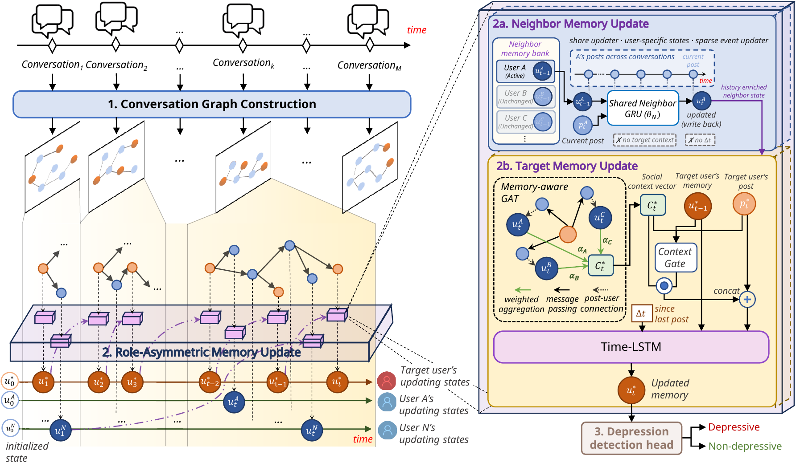

# PsyTCG: Modeling Interpersonal Psychological Dynamics via Role-Asymmetric Temporal Conversation Graphs for Depression Detection
**Official implementation of our paper accepted at EACL 2027**

This repository provides the official implementation of **PsyTCG**, a framework for depression-risk detection from social-media conversations and longitudinal user histories.

This public release contains the main PsyTCG model, the controlled GAT--TLSTM baseline, and two LLM baselines.



## Model overview

PsyTCG has four main stages:

1. **Conversation graph construction.** Each post or comment is represented by sentence-level relevance, symptom-severity, emotion, and contextual features. Reply relations form a temporal graph for every conversation.
2. **Role-asymmetric memory.** A shared GRU updates persistent, author-specific memories for interlocutors, while a Time-LSTM updates the target user's memory using elapsed time between target posts.
3. **Memory-aware graph attention and context gate.** Attention combines the current target post with neighboring post representations and their accumulated author memories. A learnable gate controls how much social context enters the target update.
4. **Depression detection head.** The updated target memory produces a round-level depression-risk score for streaming inference.

## Repository structure

```text
.
├── config/
│   ├── data_processing.yaml       # sentence/graph preprocessing defaults
│   ├── llm.yaml                   # both LLM-baseline settings and prompts
│   ├── psytcg_erisk2025.yaml      # main-model paper setting
│   ├── psytcg_erisk2026.yaml
│   ├── gat_tlstm_erisk2025.yaml   # controlled-baseline paper setting
│   ├── gat_tlstm_erisk2026.yaml
│   ├── schema.py                  # validated model/training configuration
│   └── REPRODUCIBILITY.md
├── data_processing/
│   ├── pre_infer_sent.py          # raw text -> sentence features
│   ├── pre_infer_graph.py         # sentence features -> conversation graphs
│   ├── build_graph_pkl.py         # raw collection -> model-ready graph pickle
│   ├── dataset.py
│   ├── labels.py
│   └── README.md                  # accepted raw-data and pickle schemas
├── model/
│   ├── psytcg.py                  # main PsyTCG model
│   ├── gat_tlstm.py               # GAT--TLSTM baseline
│   └── components.py              # post encoder, Time-LSTM, memory attention
├── training/
│   ├── train_psytcg.py
│   ├── train_gat_tlstm.py
│   ├── trainer.py
│   └── experiment.py
├── infer/
│   ├── infer_psytcg.py
│   ├── infer_gat_tlstm.py
│   ├── llm_conversation.py        # LLM baseline: pruned conversation context
│   ├── llm_timeline.py            # LLM baseline: recent target-user timeline
│   ├── loaders.py
│   └── runner.py
├── evaluation/
│   ├── evaluate_psytcg.py
│   ├── evaluate_gat_tlstm.py
│   ├── evaluate_llm.py
│   ├── metrics.py                 # Precision, Recall, and F1 only
│   └── runner.py
├── utils/
│   └── common.py
├── figures/
│   ├── model.png
│   └── model.pdf
├── tests/
├── pyproject.toml
├── requirements.txt
└── LICENSE
```

## Installation

Python 3.10 or newer is required. Install the main model, preprocessing stack, and GAT--TLSTM baseline with:

```bash
python -m venv .venv
source .venv/bin/activate
python -m pip install --upgrade pip
pip install -e ".[preprocess,gat-baseline]"
```

For the exact library versions recorded for the paper, see `requirements-paper.txt`. The LLM baselines additionally require a CUDA-compatible [vLLM](https://docs.vllm.ai/) installation; install the vLLM wheel appropriate for the machine's CUDA and PyTorch versions.

## Data preparation

The eRisk datasets are restricted and are not redistributed. The accepted raw JSON schemas and the generated pickle schema are documented in [`data_processing/README.md`](data_processing/README.md).

Set the sentence models and preprocessing defaults in `config/data_processing.yaml`, then build one graph pickle per collection:

```bash
python -m data_processing.build_graph_pkl \
  --mode conversation \
  --raw-dir data/raw/2026 \
  --output data/graphs/2026.pkl
```

For post-only collections with generated replies:

```bash
python -m data_processing.build_graph_pkl \
  --mode posts \
  --raw-dir data/raw/2017 \
  --synthetic-comments data/raw/2017_replies.json \
  --user-prefix 2017_ \
  --output data/graphs/2017.pkl
```

## Training

All dataset paths, architecture settings, optimization parameters, seeds, and output paths are stored in `config/*.yaml`.

Train the main model:

```bash
python -m training.train_psytcg \
  --config config/psytcg_erisk2026.yaml
```

Train the controlled GAT--TLSTM baseline:

```bash
python -m training.train_gat_tlstm \
  --config config/gat_tlstm_erisk2026.yaml
```

The baseline reuses the common post-encoder checkpoint, but its GATv2 layer is
initialized from scratch and trained with the Time-LSTM and classification
layers. It does not load or require a pretrained GAT checkpoint.

Each run writes the resolved configuration, validation-selected checkpoint, per-seed history, predictions, and Precision/Recall/F1 summaries under the configured `output_dir`. See [`config/REPRODUCIBILITY.md`](config/REPRODUCIBILITY.md) for the complete paper protocol.

## Inference

PsyTCG:

```bash
python -m infer.infer_psytcg \
  --config config/psytcg_erisk2026.yaml \
  --checkpoint runs/erisk2026/seed_3407/checkpoint.pt \
  --timelines data/graphs/2026.pkl \
  --output outputs/psytcg
```

GAT--TLSTM:

```bash
python -m infer.infer_gat_tlstm \
  --config config/gat_tlstm_erisk2026.yaml \
  --checkpoint runs/gat_tlstm_erisk2026/seed_3407/checkpoint.pt \
  --timelines data/graphs/2026.pkl \
  --output outputs/gat_tlstm
```

Both commands write `predictions.csv` and the full streaming decision sequence in `run.json`.

The two LLM baselines read defaults and prompts from `config/llm.yaml`:

```bash
# Pruned conversation context
python -m infer.llm_conversation \
  --raw-dir data/raw/2026 \
  --output outputs/llm/conversation.jsonl

# k most recent target-user posts/comments
python -m infer.llm_timeline \
  --raw-dir data/raw/2026 \
  -k 10 \
  --output outputs/llm/timeline_k10.jsonl
```

Use `--dry-run` to validate and prune the LLM input without loading vLLM or writing predictions.

## Evaluation

The release reports only user-level **Precision**, **Recall**, and **F1**. A user is predicted positive once any observed round is positive; golden users without a usable timeline or prediction remain negative predictions.

Evaluate PsyTCG:

```bash
python -m evaluation.evaluate_psytcg \
  --config config/psytcg_erisk2026.yaml \
  --checkpoint runs/erisk2026/seed_3407/checkpoint.pt \
  --timelines data/graphs/2026.pkl \
  --labels data/labels/2026.txt \
  --output outputs/evaluation/psytcg
```

Evaluate GAT--TLSTM by replacing the module with `evaluation.evaluate_gat_tlstm` and using its matching config/checkpoint. Evaluate either LLM JSONL file with:

```bash
python -m evaluation.evaluate_llm \
  outputs/llm/conversation.jsonl \
  --golden data/labels/2026.txt
```

## Tests

```bash
pip install -e ".[dev,preprocess,gat-baseline]"
pytest -q
ruff check .
```

## Data use and ethical scope

This software is research code for evaluating population-level benchmark performance. It is not a clinical diagnostic system and must not be used to make automated decisions about individuals. Follow the eRisk data-use agreement, do not publish restricted text or derived artifacts that could reveal users, and report only aggregate results.

## License

The source code is released under the [MIT License](LICENSE). Dataset licenses and model-checkpoint licenses apply separately.

## Citation

```bibtex
@unpublished{tran2027psytcg,
  title  = {{PsyTCG}: Modeling Interpersonal Psychological Dynamics via Role-Asymmetric Temporal Conversation Graphs for Depression Detection},
  author = {Tran, Duc-Luong and Mai, Tu-Phuong and Chu, Phuong-Anh and Do, Hoang-Dat and Can, Duy-Cat and Ch{'e}n, Oliver Y. and Le, Hoang-Quynh},
  note   = {Accepted at the 20th Conference of the European Chapter of the Association for Computational Linguistics (EACL 2027)},
  year   = {2027}
}
}
```
